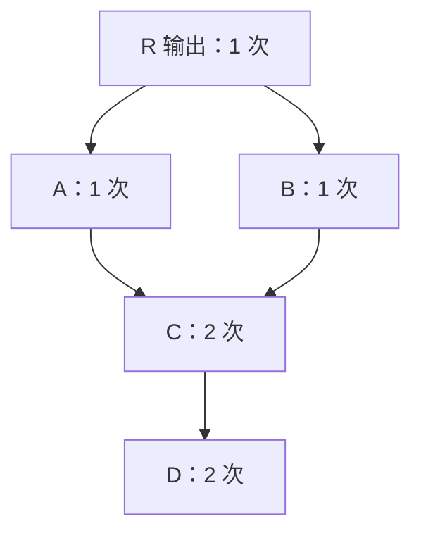
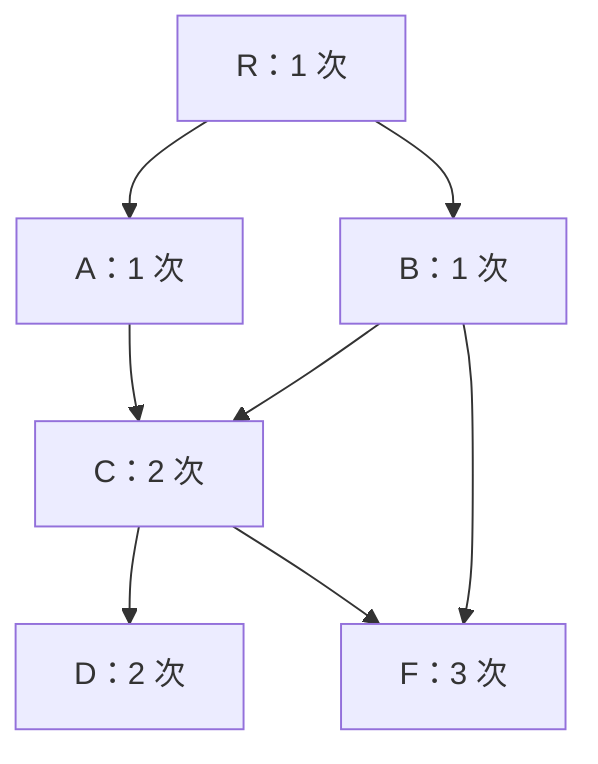
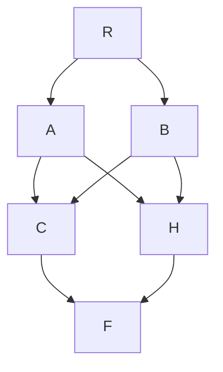

# MetricFlow 公共分支识别与 CTE 复用

本文解释 `DataflowPlanAnalyzer.find_common_branches()` 如何在已经构建、优化的数据流 DAG 中选择公共分支，以及它为什么不负责判断“上层节点能否代替另一个输入节点”。

核心区别：计数器发现所有重复到达的节点；筛选 Visitor 沿每条路径选择首先遇到的公共节点；外层迭代进一步寻找这些分支内部的共享结构。返回集合用于选择 CTE，不用于删除其他计算节点。

## 图的方向与算法输入

本文箭头统一表示 `当前节点 -> parent_nodes 中的上游输入`，与实际数据流动方向相反。C、D、F 等字母表示已有的节点，同名字母不是各自新建的副本。

算法输入是数据流 DAG，不是指标定义依赖图。一个指标分支可能包含读取、时间变换、JOIN、过滤、选列、聚合、指标计算等多个节点。

共享结构在分析之前已经形成，例如：

- 指标依赖转换时复用同一个指标的数据流输出。
- 多个指标分支选用同一个来源节点。
- 数据流优化器合并兼容分支。

本算法不通过比较 SQL 文本或子图形状来发现“看起来相同”的计算，也不在此合并节点。

<a id="counting"></a>

## 路径计数

`_find_largest_common_branches(nodes)` 先创建一个新的 `_CountDataflowNodeVisitor`，再让本轮每个起点接受这个 Visitor：

```python
counting_visitor = _CountDataflowNodeVisitor()
for node in nodes:
    node.accept(counting_visitor)
```

不同类型节点的 `accept()` 经默认 Visitor 的 `visit_*` 方法转到同一个 `_default_handler()`：

```python
for parent_node in node.parent_nodes:
    parent_node.accept(self)
self._node_to_count[node] += 1
```

它先递归访问上游，再在返回时给当前节点计数加一。没有全局 visited 去重：同一节点经另一条路径到达时，会再次递归访问其上游。

因此计数表示“从本轮起点集合出发到达这个节点的路径次数”，不是直接消费者个数，更不是数据库实际扫描次数。第一轮起点只有 sink，后续轮次会更换起点并重新计数。

## 示例一：公共节点不等于最终选中的分支



计数器从 R 出发，分别走过 `R -> A -> C -> D` 和 `R -> B -> C -> D`。C、D 均被到达两次：

```text
common_nodes = {C, D}
```

接下来 `_FindLargestCommonBranchesVisitor` 使用这个集合筛选：

```python
if node in self._common_nodes:
    return FrozenOrderedSet([node])

result = MutableOrderedSet()
for parent_node in node.parent_nodes:
    result.update(parent_node.accept(self))
return result
```

这里 `result` 是便于阅读的简写，对应源码的 `largest_common_branch_roots`。

搜索路径与返回值：

| 搜索路径 | 返回值 | 停止原因 |
|---|---|---|
| R -> A -> C | `{C}` | C 是此路径首先遇到的公共节点，不再进入 D |
| R -> B -> C | `{C}` | 同上 |

外层执行 `common_branches.update(...)` 后得到 `{C}`。集合只负责汇总与去重，D 没有被集合删除，而是筛选阶段根本没有返回它。

“largest” 指沿当前路径尽量靠近输出端的共享分支根。C 代表的计算已经包含上游 D，选 C 可以覆盖整段 `C -> D`。它不表示访问次数最大、数据量最大或数据库成本最低。

下一轮以 `{C}` 为起点重新计数，C、D 都只到达一次，没有新的公共分支，算法结束。D 的计算仍然存在，可以包含在 C 的 SQL 内部。

<a id="nested-sharing"></a>

## 示例二：C 和 B 都直接使用 F

在上一张图增加 `C -> F` 和 `B -> F`：



F 的三条到达路径为：

```text
R -> A -> C -> F
R -> B -> C -> F
R -> B -> F
```

第一阶段得到 `common_nodes = {C, D, F}`。第二阶段：

| 搜索路径 | 返回值 |
|---|---|
| R -> A -> C | `{C}`，停止，不再访问 C 内的 D、F |
| R -> B -> C | `{C}`，停止 |
| R -> B -> F | `{F}`，停止 |

最终 `common_branches = {C, F}`。沿一条路径停止，不会禁止其他路径访问该节点的上游；结果也不要求所选节点之间不存在祖先关系。

对应 SQL 复用意图是：F 单独定义，C 引用 F，而 B 可以同时引用 C 与 F。不是将 F 的整段 SQL 必然重复展开在 C、B 中。

## 为什么不能直接删掉 B 到 F 的依赖

C 使用 F，不意味着 C 对外输出 F 的全部信息。例如 C 可能只输出一个比率，B 却同时需要这个比率和 F 的原始统计值。

但用户提出的另一种情况也完全可能：C 已透传 B 所需的 F 信息，且粒度、过滤和时间语义一致，此时 B 或许可以只使用 C。

要进行这种改写，需要证明：

1. C 输出 B 所需的全部指标与维度，并能匹配原输入规格。
2. C 没有改变 B 需要的粒度、时间范围、过滤语义或行集合。
3. 替换后 B 的结果保持一致。

`_FindLargestCommonBranchesVisitor` 不检查这些输出语义，只读取公共节点集合与 parent_nodes，也不改写依赖边。因此返回 `{C, F}` 不是断言 F 无法被 C 替代，而是在当前图上识别独立的复用需求。

`PassThroughMetricEvaluationPlanner` 允许计算派生指标的节点透传输入指标，并选择可供上层使用的查询节点，是相关的另一层规划机制。它不是此 Visitor 的一部分，也不能认为启用它就必然消除所有冗余依赖。

<a id="iteration"></a>

## 外层为什么还要迭代

`find_common_branches()` 维护两种集合：

- `branch_roots_to_scan`：本轮重新计数的起点。
- `all_common_branches`：各轮选中分支的累计结果，保持发现顺序并去重。

每轮使用全新的计数器，选出分支后，再以这些分支作为下一轮起点。遇到空结果就结束，最多执行 10 轮，达到上限时记录警告并返回已找到的结果。

例如下面的图，第一轮选 C、H 时会遮住更深的 F：



```text
第 1 轮：起点 {R}    -> C、H 各 2 次，F 4 次 -> 选中 {C, H}
第 2 轮：起点 {C, H} -> C、H 各 1 次，F 2 次 -> 选中 {F}
第 3 轮：起点 {F}    -> F 1 次              -> 空，结束
累计结果：{C, H, F}
```

外层不是逐步收集第一轮全部公共节点；它寻找的是“选中分支之间是否还有共享计算”。示例一中的 D 因为只被选中的 C 包含，不会自动被补入。

## 与 case10 的对应

此前单独运行 case10 时，优化后的顶层 Combine 接收五个分支，输出七个指标：派生指数、比率、合并后的收入/销量/明细数、注册数、时间脊明细数。

第一轮从 sink 计数得到的关键结果：

| 节点含义 | 本次节点 ID | 到达次数 |
|---|---|---:|
| 比率 orders_per_signup | cm_9 | 2 |
| 注册数 user_signups | cm_8 | 3 |
| 订单来源的 metric_time 变换 | sma_10001 | 4 |
| 用户来源的 metric_time 变换 | sma_10002 | 7 |

第一轮选中 `{cm_9, sma_10001, sma_10002, cm_8}`。后续轮次重新扫描的结果依次为 `{sma_10001, sma_10002, cm_8}`、`{sma_10002}`、空；累计集合仍是这四个节点。节点编号依运行上下文变化，以指标和节点类型定位为准。

<a id="cte"></a>

## 从选择结果到 CTE

`DataflowToSqlPlanConverter._get_nodes_to_convert_to_cte()` 调用分析器，把返回节点作为待转换 CTE 的集合。SQL Visitor 后续才负责生成 CTE 定义与引用。

这是 SQL 表达层面的共享，不保证数据库一定物化 CTE 或只执行一次。数据库的内联、物化和物理执行策略属于后续执行优化问题。

当前算法也不是成本优化器。计数阶段重复展开路径；在共享路径很多的 DAG 中，工作量可能远大于节点数与边数之和。它的职责是按已有拓扑识别公共分支，不是证明生成计划全局最优。

## 断点与源码入口

- `../metricflow/dataflow/dataflow_plan_analyzer.py`：`_CountDataflowNodeVisitor._default_handler()`，观察递归返回后的 `_node_to_count`。
- 同文件：`_find_largest_common_branches()`，对比 `common_nodes` 与 `common_branches`。
- 同文件：`_FindLargestCommonBranchesVisitor._default_handler()`，观察命中公共节点时的提前返回。
- 同文件：`find_common_branches()`，观察每轮起点与累计结果的区别。
- `../metricflow/plan_conversion/to_sql_plan/dataflow_to_sql.py`：`_get_nodes_to_convert_to_cte()`，观察分析结果怎样交给 SQL 转换。
